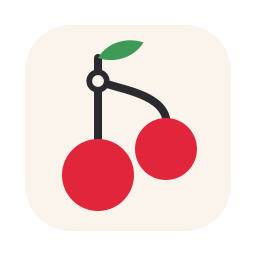

# CherryPeek

[中文](README.md) | English

A desktop Git history browser for repositories that move fast — for example when coding agents commit many times a day. See at a glance how much was committed recently, by whom, what changed, and how branches relate. Browsing leaves your working tree untouched; basic Git operations require an explicit action.

> **Status: early preview (0.1).** macOS on Apple silicon only. Read-only browsing and allowlisted review/sync operations are ready; long-running stability, Windows and Intel Macs are not covered yet. The name is a play on cherry-pick: peek at commits without touching your working tree. (Earlier documents call it CommitScope, and internal identifiers still use `commitscope`.)

## What it does

- **History** — a virtualized commit list with a branch graph, built for large repositories (tested with 100,000 commits and 1,000 refs). Pick any branch, tag or worktree as the scope; switching scope never checks anything out.
- **Commit details on one page** — full message and trailers, author and committer, parents, which branches contain the commit, a compact change summary, then every changed file with its diff (unified or side by side, changes only or the whole file).
- **Search** — message, author / committer, sub-day / minute-precise time, update/unseen batch, OID and path filters with removable filter chips over a local index, with results that stay put while the index fills in. Locate any result in the full history and come back to the results.
- **Files** — browse the tree of any commit, a file's or a directory's history beside it, a change view that slides over the file, line-by-line blame, and a switcher through all files of a commit.
- **Workspace & Review Gate** — inspect staged, unstaged, untracked, and conflicted files of the current worktree with their diffs; hand uncommitted changes off to an Agent for read-only review or organized committing, or stage/unstage per file or in bulk, discard a single unstaged/untracked change behind a confirmation dialog, load pending commit drafts (`MERGE_MSG` / `SQUASH_MSG` / modified `COMMIT_EDITMSG`), and commit after reviewing your message (hook failures preserve both staged changes and your message, with a handoff to an Agent).
- **Statistics (⌘4)** — supports 1h / 3h / 6h / 12h presets, minute-precise custom ranges, and one-click batch filtering alongside commit activity (period comparisons, weekday × hour heatmap, rhythm, message types, revert/fix counts and per-branch breakdown); change totals, hot directories/files with drill-down and per-repo exclusion rules; notable files (churn, co-changed pairs, solo directories, code without tests) with commit popovers; and on-demand code evolution (estimate, code age, ownership and weekly survival). Drag across any time bar chart to zoom in or filter the commits page.
- **Merged status** — branches merged into the default branch by reachability, or by patch content when they were squashed or rebased.
- **Navigation and desktop integration** — back / forward across pages (`⌘[ / ⌘]`), `⌘1 / 2 / 3 / 4` to switch pages, a `⌘K` quick jump to commits, branches and worktrees, opening repositories via `⌘O` or dragging a folder into the window, and remembered window bounds. Shortcuts keep one meaning across every page (the full list is under the keyboard icon in the top bar).
- **Hand-off to an agent** — copy a ready-made prompt to review a commit, explain a merge, review uncommitted workspace changes, or review hundreds of commits since the last update or visit (with full topological counts and head/tail summaries).
- **Updates, push, branch cleanup, and lightweight diverged merge** — the toolbar's “更新 <branch>” button fetches and fast-forwards the checked-out branch, while ahead or unpublished local branches offer a cancellable “推送 ↑N / 发布分支” non-force push control alongside it. When branches diverge on update, push, or fast-forward merge, you can hand off to an Agent or click “同步 / 解决冲突…” for a zero-write isolated three-way preview: clean divergences offer a two-parent merge commit or single-commit linear rebase (preserving the original author metadata) with optional immediate non-force push, while small ordinary text conflicts (up to 10 files) can optionally be opened in a JetBrains-style left-center-right three-pane resolver with bilateral `»` / `«` sequential append arrows, `×` ignore, `↺` reset, and in-pane edits before an atomic one-shot commit (cancelling leaves the repository completely untouched; structural/binary/criss-cross cases still hand off to your Agent). From the scope picker or `⌘K`, you can also switch branches, create branches, fast-forward update non-HEAD branches, fast-forward merge into a local target, and directly delete local branches that are ancestor-merged and not checked out elsewhere.

## Browsing and basic operations

- Browsing a branch does not switch your working tree. CherryPeek only executes allowlisted, single-step safe operations: explicit Fetch, fast-forward update and fast-forward merge, zero-intermediate-state diverged sync and atomic three-pane resolution for small ordinary text conflicts on a clean tracked worktree, switching and creating branches, deleting ancestor-merged un-checked-out branches, non-force push, and workspace staging/confirmed discard/commit. It never auto-fetches, runs `--force` push, `reset`, `stash`, multi-step `rebase`, `cherry-pick`, `revert`, structural/binary conflict resolution, or takes over an in-progress `MERGE_HEAD` / `rebase-merge`; complex cases hand off to your Agent.
- Repository contents are treated as untrusted text; the window is sandboxed.
- Caches and the search index live in `~/Library/Application Support/CherryPeek`, never inside your repositories. Delete that folder to remove everything the app stored.

## Install

1. Download `CherryPeek-<version>-arm64.dmg` from [Releases](../../releases) (the app is signed and notarized by Apple).
2. Open it and drag CherryPeek into Applications.

Requirements: a Mac with Apple silicon, macOS 12 or later, and Git (the system Git from the Xcode Command Line Tools is enough: `xcode-select --install`).

## Build from source

Requirements: Node.js (see `.node-version`), pnpm 10, a Rust toolchain (see `rust-toolchain.toml`) and Git.

```sh
pnpm install
pnpm dev                 # build and start the app
pnpm start               # start the last build
pnpm package:mac         # an unsigned .app / .dmg for this Mac, in release/
```

Signed releases are built with `pnpm release:mac`; see [docs/RELEASE.md](docs/RELEASE.md) (in Chinese).

Development notes (progress, the full document index, test commands and project layout) are in [docs/DEVELOPMENT.md](docs/DEVELOPMENT.md). The product, design and architecture documents in [docs/](docs/) are written in Chinese.

## License

[MIT](LICENSE). Third-party licenses are listed in [THIRD_PARTY_LICENSES.md](THIRD_PARTY_LICENSES.md) and ship with the app.
