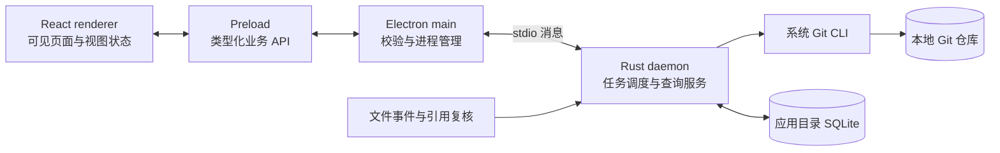

# 技术架构

日期：2026-11-07。P0-01 已验证 Electron / Rust 启动与隔离，P0-02 已验证版本握手、请求分块、取消、超时、上下文判旧与进程回收，证据见 [P0-01](validation/p0-01-bootstrap.md)、[P0-02 验收记录](validation/p0-02-protocol.md)。P0-03 已增加真实仓库首屏与[测量记录](benchmarks/p0-03-first-screen.md)，P0-04 已完成[读取路线决策](decisions/0001-git-reader.md)和[M0 基线](benchmarks/m0-baseline.md)，保留 Git CLI 进入 M1。P1-01 的 head 会话、本地查看记录与非视觉接口已通过[验收](validation/p1-01-repository-sessions.md)；下述多范围快照、分页、事件、索引与查询缓存仍属设计，不代表发布性能已验收。

## 技术路线

| 层 | 选择 | 职责和约束 |
| --- | --- | --- |
| 桌面外壳 | Electron | 窗口、菜单、目录选择、进程生命周期、系统集成 |
| 界面 | React + TypeScript；Vite 构建 | 视图、筛选、选中状态、快捷键、虚拟列表与可见分支线绘制 |
| 核心 | Rust 常驻子进程 | 仓库发现、查询调度、Git 读取、图布局、缓存、索引、活动统计 |
| Git 主读取路线 | 系统 Git CLI，由 Rust 管理 | M0 实测后确认；批量和流式读取，不为每行提交启动一次进程 |
| 局部读取实验 | gix 0.90.0，仅 dev-dependency | 已比较对象读取 / 历史遍历；本次不进入生产路径，后续按瓶颈证据再评估 |
| 存储 | SQLite，按需增加 FTS5 | 提交元数据、查询缓存、索引覆盖状态；不保存全库 patch |
| Diff | 按需加载的只读文本视图 | 先统一 diff；需要双栏时再验证 Monaco 的增量成本 |

Electron 已确定。Rust 保留为独立进程，便于调试、取消任务和分别测量资源；原生 Node 模块只在 IPC 成为实测瓶颈时评估。GitComet 不作为依赖、代码来源或 fork 上游。

Git CLI 提供批量对象读取；M0 的同 fixture 比较支持继续使用 CLI，gix 在已知 OID 的对象读取上有局部收益，但完整历史页更慢，实验 topo 路径还有浅克隆缺口，详见 ADR 0001。[Git cat-file 文档](https://git-scm.com/docs/git-cat-file)、[gitoxide 项目](https://github.com/GitoxideLabs/gitoxide)。依赖版本和工具链在 M0 固定，不在规划阶段臆定“最新版本”。

## 数据流

Electron 的 preload 通过 `contextBridge` 提供窄接口，main 负责 IPC 路由；耗时读取在 Rust 处理，main 与 renderer 不执行同步 Git 或全库解析。[Electron IPC](https://www.electronjs.org/docs/latest/tutorial/ipc)、[性能建议](https://www.electronjs.org/docs/latest/tutorial/performance)。

## 进程与协议

main 使用异步 `spawn` 启动随应用打包的 Rust 可执行文件，通过 stdin/stdout 交换 UTF-8 JSON Lines；stdout 仅为协议，日志走 stderr。JSON 中的换行必须转义。实现时锁定 Electron 内置 Node 对应的 API，并分别验证 macOS 与 Windows 的启动和回收。[Node 子进程文档](https://nodejs.org/api/child_process.html)。

初始协议使用单个版本号和共享 schema，生成 TypeScript 类型并保留 Rust 编解码样例，避免双侧手写类型漂移。暂不建设通用插件协议。

P0-02 的已实现契约见 [代码级计划](implementation/p0-02-protocol.md)：`hello`、`request`、`response`、`cancel`、`error` 五类消息，P0-03 新增 `readRepositoryPreview`，当前能力包含 `getRuntimeInfo` 与有界仓库预览。Git 版本探测使用固定绝对路径、有界输出与 2 秒上限；启动与默认请求上限为 5 秒，每会话最多两个请求。renderer 通过窄业务 API 获取核心状态和仓库预览，支持目录选择、打开与取消，不持有通用请求权限。macOS 通过本次 daemon 的独立进程组清理其 Git 子进程；Windows 的整树回收待单独实现和验收。

P1-01 的会话契约见[代码级计划](implementation/p1-01-repository-sessions.md)：新增 `repositorySessions` capability，提供打开、读取会话、有界预览、显式记录查看、关闭与最近仓库六个方法。每个连接保留一个当前会话；打开时冻结 HEAD，尚不覆盖多引用范围、游标或自动刷新。稳定的 repositoryKey / worktreeId 区分对象库与 worktree，本次打开的 repoId / generation 使用随机标识并在重启后失效。server 主循环串行提交会话变更，Git 发现和历史读取仍在可取消 worker 中执行。

main 持有会话上下文，preload 不接受 renderer 指定的 repoId / generation。open 的取消会等到核心最终响应，以同步可能已提交的状态；会话变更超时导致核心连接失败并回收，避免继续使用不确定的句柄。六个 IPC 接口返回可序列化的成功 / 错误结果。旧预览接口保留独立的 null 上下文；新接口是否接入界面与后端验收分开记录。UI-02 起 renderer 只用会话接口：打开、读取、取消（即关闭会话）与记录查看都由 renderer 发起，并按操作号丢弃过期结果；旧的 renderer 预览接口已移除，daemon 的 `readRepositoryPreview` 仍供 headless 测试与基准使用。`--repository=` 启动参数经 `getLaunchRepository` 交给 renderer，按正常路径打开。

| 消息 | 必备字段和行为 |
| --- | --- |
| 握手 | `protocolVersion`、核心版本、Git 版本与能力；不兼容时给出错误，不继续发查询 |
| 请求 | `requestId`、`method`、`repoId`（打开仓库前可空）、`generation`、`params` |
| 响应 | 回传请求上下文；分批结果包含 `sequence`、`done`、覆盖状态及下一页游标；搜索页游标还绑定结果版本 |
| 事件 | 索引进度、引用变化、仓库不可用；包含 `repoId` 与对应 generation；引用变化事件通知最新已观察快照，不自动替换当前浏览快照 |
| 取消 | 按 `requestId` 取消，幂等；终止关联 Git 子进程 / 遍历，已入队结果仍需前端判旧 |
| 错误 | 稳定错误码、可展示信息、是否可重试；区分取消、失效游标、缺失对象、无 Git、协议错误 |

`generation` 标识不可变的仓库引用快照；每个会话分别记录当前浏览与最新已观察的 generation。外部引用变化只推进最新已观察版本，当前请求仍可在所绑定的旧快照上继续完成。筛选变化沿用当前浏览快照并分配新的 `requestId`；主动切换仓库 / 范围或点击刷新后建立新的浏览上下文，再取消被替代的请求。响应按当前会话、浏览 generation 与请求标识判旧，不能仅因出现更大的已观察 generation 就拒绝仍属当前视图的结果。事务完成前失败不能返回 `done: true` 的成功结果。参数、长度、页大小和 repo handle 均在受信任层校验。

默认历史页 200 行，最大 500 行；单帧上限初定 1 MiB，超限使用可取消的分块或明确截断。流输出设有界队列和背压；重试不能无限堆积任务。每个仓库先限制两个交互任务与一个低优先级索引任务，索引在交互繁忙时让出资源，后续以测量调整。

关闭仓库释放 session；退出应用先取消任务，再回收 daemon 和其 Git 子进程。daemon 崩溃时保留 UI 选择、拒绝待完成请求，允许重新打开；不自动陷入重启循环。平台差异必须通过进程树残留测试。

P0-03 的仓库预览契约见[代码级计划](implementation/p0-03-repository-preview.md)：固定本次 HEAD OID，最多 200 条摘要 / 2,000 条引用；响应按实际编码字节分块，目标每帧不超过 512 KiB。Git 总读取截止 15 秒，桌面请求 20 秒。`repoId` / `generation` 暂为 null，`coverage.complete` 只表示本次有界预览完成；`hasMore` 明确仍有历史。refs 是独立命令的观察结果，不宣称与 HEAD 构成原子快照。

## 查询接口与数据模型

首批接口：`openRepository`、`closeRepository`、`listRefs`、`listWorktrees`、`readHistoryPage`、`searchCommits`、`getActivity`、`getCommit`、`listChangedFiles`、`readDiff`、`locateCommit`、`refreshRepository`、`cancelRequest`，以及界面 v3 需要的 `refMergeStatus`、`branchesContaining`（见下方“引用关系”）、`diffRefSnapshots`（见“上次查看与更新明细”）和 `getHandoffFacts`（见“交给 Agent”）。

- `Repository` 分开记录规范化目录、gitDir、commonDir、worktreeId、objectFormat 和能力边界。linked worktree 的共享对象与独立 HEAD 不能混为同一视图。[Git worktree 文档](https://git-scm.com/docs/git-worktree)。
- `Commit` 以仓库对象库标识 + 完整 OID 为键，保存有序 parent OID、消息、Author / Committer 和各自时间。OID 以算法和字符串表达，不固定 SHA-1 长度。
- `RefSnapshot` 保存引用名称、种类、目标及解析到的 commit OID；查询开始固定 tip OID 集合，不在翻页期间重新解释移动中的分支名。当前快照的引用标签与实际工作区最新 HEAD 状态分别标明，不能把新引用标签混入旧历史而不说明。
- `Query` 包含范围、消息子串、Author / Committer 独立身份集合、OID 筛选、路径、日期条件、文本大小写选项、时间字段、时区、排序和 generation；完整序列化后形成缓存键。不同字段 AND、同一身份集合内 OR，由 Rust 统一执行；renderer 不自行扩大检索字段或推断 hash 模式。
- `Coverage` 记录索引已完成的范围 / 快照、已处理量、是否 complete 与是否过期。完整性始终相对绑定快照；“该快照已完成”与“存在更新快照”可以同时成立，但不能复用为新快照的完整性证明。若总量未知，显示已处理数量，不编造百分比。
- **引用关系**：`refMergeStatus` 在打开范围选择器时计算本地分支相对默认分支的合入状态（口径见 PRODUCT 数据口径）。先判断可达（第一版只做这一步）；M4 起，不可达时再比对补丁：分别为分支自分叉点以来独有的提交、基准自分叉点以来的提交计算 patch-id（等价 `git cherry`），再把分支整体 diff 的 patch-id 与基准提交比较，用来识别 squash。只用只读命令，不用 `git merge-tree --write-tree` 这类会向仓库写对象的路径。比对量受分叉点以来的提交数约束并设上限；超限返回“未知”，不当作未合入。结果按（基准 OID，分支 OID）缓存。分支多时只算可见项，分批返回；`branchesContaining` 只在用户点击“包含它的分支”时计算。两者都绑定当前浏览快照，可取消，可按快照缓存，不预先物化“所有分支 × 所有提交”。worktree 检出关系来自 `listWorktrees`；远端跟踪引用是否一致直接比较 `RefSnapshot` 中的 OID。`getActivity` 同时返回按日计数和按原始 Author 身份的去重计数，口径与筛选和历史一致。
- **上次查看与更新明细**：应用数据目录按（仓库对象库标识，worktreeId，浏览范围）保存上次查看的 tip OID 集合，不写被查看仓库。P1-01 先用版本化 JSON 保存最近 20 个 worktree 与最多 100 条查看记录，两个文件各限 1 MiB；main 配置可信数据目录，路径落在被查看仓库内时禁用存储。打开只写 recent；内容实际显示后由调用方显式记录会话捕获的 tips，不读取外部最新 HEAD。首次查看为 null，曾查看空仓库为 `[]`；坏文件保留并报告状态，不阻止浏览。P1-05 引入 SQLite 元数据索引，不把它作为 P1-01 的前置条件。后续 `readHistoryPage` 的行带 `isNewSinceLastSeen`，由“当前 tips 可达、上次 tips 不可达”在遍历时标注，不另行全量计算。`diffRefSnapshots` 比较当前浏览 generation 与最新已观察 generation：逐个引用给出快进 / 改写 / 新建 / 删除，快进附新增提交的有界摘要，改写附被替换数量；只在用户打开更新明细时计算，可取消，结果按两个 generation 缓存。
- **详情扩展**：`getCommit` 按 Git trailer 规则拆出 trailer，返回原始消息与解析结果，不读取外部配置改变解析方式。merge 的“带入的提交”复用 `readHistoryPage`，范围为“包含第 N 父、排除第一父”，与普通分页共享游标、取消与有界页面。
- **交给 Agent**：`getHandoffFacts` 只读计算 prompt 所需事实：领先 / 落后计数（`rev-list --left-right --count` 口径）、分叉点以来两侧改动路径的交集、分支独有提交标题的有界列表，全部绑定当前浏览快照；字段与模板见 [HANDOFF](HANDOFF.md)。模板在 renderer 渲染；仓库来源文本经转义后放进带随机分隔标记的参考数据段，文本中出现同一标记时换一个。复制经 preload 暴露的 `copyText` 窄接口，由 main 写系统剪贴板，仅响应用户点击，长度设上限。复制动作不启动外部进程、不调用 Agent；事实计算可调用受只读边界约束的 Git，整个流程不执行 Git 写操作。

## 历史分页与图布局

首屏只取 OID、父提交、标题、作者、时间及引用标签；完整消息、文件列表、patch、改动行数和签名信息按需读取。普通历史不等待总条数，也不等待完整索引。

分页游标绑定查询、引用快照、遍历位置和图布局状态。Rust 保持有界的遍历 session，按需继续读取；不把 `--skip=N` 的反复全量遍历当最终分页方案。回滚到被淘汰的页时，可用检查点恢复或重算，并记录延迟；session 过期返回明确错误。M0 已确认每页从 HEAD 重算约 0.44 秒，需优先续读已有遍历；现有数据不足以决定检查点落盘格式，待 M1 测量随机回读与淘汰成本再选择，避免提前存储完整可达矩阵。

Rust 生成每行的 lane、父边与跨页连接信息；React 仅渲染可见行和少量缓冲。布局检查点记录边界上的活跃 lane；同一快照内向前 / 向后翻页不让颜色和连线无故跳动。octopus merge、长边、detached HEAD 和浅克隆边界都有 fixture。

文本 / 路径搜索先输出独立结果列表，不伪造被过滤节点之间的父子关系。“在历史中定位”恢复原范围、原快照的拓扑视图；取消全部字段筛选前保存查询和滚动锚点。元数据搜索在 M1 独立交付，此定位与返回能力在 M2 图布局就绪后接入。

## 搜索、索引和统计

先流式提供历史，随后低优先级建立 SQLite 元数据索引。M1 在分页稳定后实现索引与元数据搜索，不依赖完整图布局、文件列表或 diff；M3 的路径历史和统计复用同一查询语义。对象元数据与可达性分开：旧 commit 仍可保留缓存，但不应因缓存存在而重新出现在不包含它的新快照查询中。固定 tip 的遍历或按快照缓存的成员集合保证范围正确，避免预先计算所有分支 × 所有提交。

FTS5 是加速候选，不能改变产品约定的字面子串语义。M1 先建立正确且可取消的搜索基线，按测量需要比较普通索引、trigram 与扫描，后续继续优化；中文短词、标点和大小写分别验收。trigram 的全文查询对少于三个 Unicode 字符的子串有限制，短词需走等价后备路径。[SQLite FTS5 文档](https://www.sqlite.org/fts5.html#the_trigram_tokenizer)。用户输入不直接拼进 SQL 或 `MATCH` 表达式。

索引未完整时立即返回已覆盖结果，明确标记 partial，同时继续补齐所选快照范围。新命中按完整 OID 去重，按选定时间降序、完整 OID 作为稳定次序自动合并；完成前没有命中不等于最终空结果。只有覆盖完整的快照才能显示“该快照全部结果”或精确统计；后台扫描可取消。磁盘配额淘汰数据时必须同步回退 coverage。

动态搜索结果由 Rust 维护排序和结果版本，分页游标绑定查询、快照及结果版本。新批次插入造成页边界变化时，按所选 OID、视口顶部 OID 与行内偏移重新取得有界窗口和游标，不把不同版本的页直接拼接。renderer 只保留有界页面；搜索结果总量不能转化为前端全量数组。此处的结果版本变化仅表示同一快照发现更多命中，不表示已经刷新仓库引用快照。

时间过滤应遍历所需可达集合再按选定时间字段过滤，避免遇到乱序时间就提前停止。Git `--since-as-filter` 与普通 `--since` 行为不同；Author time 筛选不能直接等同于默认 Git 日期筛选。[Git log 文档](https://git-scm.com/docs/git-log)。

路径搜索按 PRODUCT 的 merge 口径验证，不直接依赖默认历史简化得到的集合。第一版不建立全库文件内容索引，不扫描每条提交的完整 patch 来做启动统计。

## 外部变化与缓存

监测 gitDir、commonDir 相关引用和 HEAD；事件合并后重新读取实际引用，应用聚焦和手动刷新时同样复核。不能只监听松散 refs，还需覆盖 packed refs 和后端能力；文件通知只是线索。可见窗口的兜底复核初定 5 秒，休眠后恢复重新核对，参数以空闲 CPU 实测调整。

引用变化后比较 OID 和可达性，区分快进与历史改写，生成新的已观察 generation，在顶部提示有更新；不替换当前浏览快照，也不反复取消其搜索或统计。无关分支变化同样不能使当前查询失效。不依据“上次时间戳”补增量。连续通知合并，仅保留活动查询所需快照和最新已观察状态，不为每次外部提交累积完整查询 session。

用户点击刷新时重新读取引用，以本次确认的快照替代旧浏览上下文，取消被替代的请求，历史、搜索和统计统一绑定新 generation。按 OID 保持选择和滚动锚点；若锚点已不在新范围，显示明确状态并提供回到顶部入口，不用行号冒充原位置。被改写或已删除分支的旧快照可继续供阅读，但要标明与最新状态不同；刷新后不得把失去可达性的旧提交带入新查询。所选引用已删除时显示范围不可用，不悄悄换成另一分支。

固定 tip 不保证对象免于外部 GC。读取当前快照时遇到缺失对象，返回缺失 / 不完整状态并保留已读内容，不自动网络补拉，也不把中断查询标为完整；允许用户重试或刷新。M1 提供手动刷新与固定快照语义，M3 再增加文件事件、聚焦与定时复核的通知。

缓存放 Electron 应用数据目录；SQLite 为可重建派生数据，schema 带版本，写入事务化，中断后可续建或重建。默认只保留一个活跃仓库的昂贵 session。初始上限：renderer 2,000 条摘要、Rust 显式缓存 128 MiB、磁盘缓存 2 GiB / 仓库；缓存上限不等于整个进程的内存上限，按 VALIDATION 单独测量。

## 只读边界

`nodeIntegration: false`、`contextIsolation: true`、`sandbox: true`；preload 仅暴露列出的业务 API，main 校验发送源。UI 仅加载打包内容，CSP 限制脚本与资源来源；commit message、路径和 diff 作为文本，不解释 HTML，不加载仓库提供的脚本或网页。[Electron 安全文档](https://www.electronjs.org/docs/latest/tutorial/security)。

Git 调用使用固定可执行文件与参数数组，不走 shell；把用户路径作为字面路径处理，OID 必须解析并校验类型。禁用 pager、外部 diff、textconv 和可能触发网络的隐式补拉；不修改 safe.directory 全局配置，不执行自动维护 / commit-graph 写入，不为显示 blob 套用 clean / smudge 过滤器。通过外部命令哨兵与仓库前后快照测试证明这些边界。

只读 diff 按选定父提交比较；root 使用对应对象格式的空树语义，不硬编码 SHA-1 空树 OID。大文本按字节 / 行数限制并明确截断；二进制、LFS 指针、gitlink 和缺失对象分别展示状态，不自动下载或展开。

## 暂缓的架构工作

首个闭环之前不做原生模块迁移、通用事件总线、插件系统、全库代码搜索引擎或多后端完整抽象。Git 适配层只围绕现有读取接口拆分；gix 是否进入生产路径，依据测量和兼容性验证单独记录决策。
