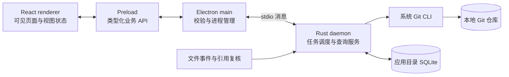

# 技术架构

日期：2026-11-08。P0-01 已验证 Electron / Rust 启动与隔离，P0-02 已验证版本握手、请求分块、取消、超时、上下文判旧与进程回收，证据见 [P0-01](validation/p0-01-bootstrap.md)、[P0-02 验收记录](validation/p0-02-protocol.md)。P0-03 已增加真实仓库首屏与[测量记录](benchmarks/p0-03-first-screen.md)，P0-04 已完成[读取路线决策](decisions/0001-git-reader.md)和[M0 基线](benchmarks/m0-baseline.md)，保留 Git CLI 进入 M1。P1-01 的 head 会话与本地查看记录已通过[验收](validation/p1-01-repository-sessions.md)；P1-02 的固定 HEAD 分页、有界页缓存、取消与手动刷新已通过[验收](validation/p1-02-history-pagination.md)及[核心分页测量](benchmarks/p1-02-history-pagination.md)。P1-03 的有界虚拟窗口、新增标记及[滚动测量](benchmarks/p1-03-history-scroll.md)已交付，短时空闲整树 RSS 尚未达到目标。P1-04 的多范围快照、worktree 导航与按需合入状态已通过[验收](validation/p1-04-scope-navigation.md)。P1-05 的可恢复 SQLite 索引及控制已通过[验收](validation/p1-05-metadata-index.md)。P1-06 的只读元数据搜索、组合筛选与动态结果分页已通过[验收](validation/p1-06-metadata-search.md)。P2-01 的 Rust 图布局与跨页检查点已通过[验收](validation/p2-01-history-graph.md)，并留下[宽图滚动测量](benchmarks/p2-01-history-graph-scroll.md)。下述事件与持久搜索结果缓存仍属设计，发布性能尚未验收。

## 技术路线

| 层 | 选择 | 职责和约束 |
| --- | --- | --- |
| 桌面外壳 | Electron | 窗口、菜单、目录选择、进程生命周期、系统集成 |
| 界面 | React + TypeScript；Vite 构建 | 视图、筛选、选中状态、快捷键、虚拟列表与可见分支线绘制 |
| 核心 | Rust 常驻子进程 | 仓库发现、查询调度、Git 读取、图布局、缓存、索引、活动统计 |
| Git 主读取路线 | 系统 Git CLI，由 Rust 管理 | M0 实测后确认；批量和流式读取，不为每行提交启动一次进程 |
| 局部读取实验 | gix 0.90.0，仅 dev-dependency | 已比较对象读取 / 历史遍历；本次不进入生产路径，后续按瓶颈证据再评估 |
| 存储 | SQLite，按需增加 FTS5 | 提交元数据、查询缓存、索引覆盖状态；不保存全库 patch |
| Diff | 按需加载的只读文本视图 | 先统一 diff；需要双栏时再验证 Monaco 的增量成本 |

Electron 已确定。Rust 保留为独立进程，便于调试、取消任务和分别测量资源；原生 Node 模块只在 IPC 成为实测瓶颈时评估。GitComet 不作为依赖、代码来源或 fork 上游。

Git CLI 提供批量对象读取；M0 的同 fixture 比较支持继续使用 CLI，gix 在已知 OID 的对象读取上有局部收益，但完整历史页更慢，实验 topo 路径还有浅克隆缺口，详见 ADR 0001。[Git cat-file 文档](https://git-scm.com/docs/git-cat-file)、[gitoxide 项目](https://github.com/GitoxideLabs/gitoxide)。依赖版本和工具链在 M0 固定，不在规划阶段臆定“最新版本”。

## 数据流

Electron 的 preload 通过 `contextBridge` 提供窄接口，main 负责 IPC 路由；耗时读取在 Rust 处理，main 与 renderer 不执行同步 Git 或全库解析。[Electron IPC](https://www.electronjs.org/docs/latest/tutorial/ipc)、[性能建议](https://www.electronjs.org/docs/latest/tutorial/performance)。

## 进程与协议

main 使用异步 `spawn` 启动随应用打包的 Rust 可执行文件，通过 stdin/stdout 交换 UTF-8 JSON Lines；stdout 仅为协议，日志走 stderr。JSON 中的换行必须转义。实现时锁定 Electron 内置 Node 对应的 API，并分别验证 macOS 与 Windows 的启动和回收。[Node 子进程文档](https://nodejs.org/api/child_process.html)。

初始协议使用单个版本号和共享 schema，生成 TypeScript 类型并保留 Rust 编解码样例，避免双侧手写类型漂移。暂不建设通用插件协议。

P0-02 的已实现契约见 [代码级计划](implementation/p0-02-protocol.md)：`hello`、`request`、`response`、`cancel`、`error` 五类消息，P0-03 新增 `readRepositoryPreview`，当前能力包含 `getRuntimeInfo` 与有界仓库预览。Git 版本探测使用固定绝对路径、有界输出与 10 秒上限（测试可用 `COMMITSCOPE_GIT_PROBE_TIMEOUT_MS` 缩短）；启动握手上限 15 秒，默认请求上限 5 秒，每会话最多两个请求。2026-11-08 起（用户确认），启动阶段的可重试失败（握手或 Git 探测超时、启动中核心退出）在“启动中”状态下暂停 1 秒、3 秒后各重启一次（状态带 `retry`，底栏显示“核心启动较慢，正在重试（第 N/2 次）”，悬停可看上一次失败原因），仍失败才显示错误；版本不匹配、找不到核心等不重试，核心就绪后的退出也不自动重启。出错后顶部提示提供“重试”，原地启动新核心；若退出前已打开仓库，就绪后重新打开同一路径。此前 P0-01 计划中的“禁止自动重启”由此调整，失败仍不得静默。renderer 通过窄业务 API 获取核心状态和仓库预览，支持目录选择、打开与取消，不持有通用请求权限。macOS 通过本次 daemon 的独立进程组清理其 Git 子进程；Windows 的整树回收待单独实现和验收。

P1-01 的会话契约见[代码级计划](implementation/p1-01-repository-sessions.md)：新增 `repositorySessions` capability，提供打开、读取会话、有界预览、显式记录查看、关闭与最近仓库六个方法。每个连接保留一个当前会话；打开时冻结 HEAD，尚不覆盖多引用范围、游标或自动刷新。稳定的 repositoryKey / worktreeId 区分对象库与 worktree，本次打开的 repoId / generation 使用随机标识并在重启后失效。server 主循环串行提交会话变更，Git 发现和历史读取仍在可取消 worker 中执行。

P1-02 按[代码级计划](implementation/p1-02-history-pagination.md)增加 `historyPagination` capability、`readHistoryPage` 和 `refreshRepository`。页大小默认 200、最大 500；返回当前页、前后页的游标与位置，`coverage.complete` 只表示这页完整，`processed` 只计本页提交。刷新先重新发现同一仓库并准备第一页，成功后再提交新 session / generation；失败保留旧会话。main 对翻页执行取消后排空终态，对会话变更接收迟到的已提交成功结果，避免核心和界面使用不同会话。记录查看时额外核验 renderer 实际显示的 generation。

P1-03 增加 `historyNewSinceLastSeen` capability。`historyPage` 的行使用扁平 `HistoryCommit`，比摘要多 `isNewSinceLastSeen`；页 metadata 增加 `newSinceLastSeenStatus` 和 `lastSeenDividerOid`，main 校验分块一致性。首次查看与比较不可用分开表示；分隔线只有在全局连续前缀已证明后出现。renderer 将窗口边缘游标与活动页分开，切仓取消并排空页请求，异步导航还核验选择意图，详见[验收记录](validation/p1-03-virtual-history.md)。

P1-04 增加桌面必需的 `repositoryScopes` capability。范围为 `"head"`、`"allBranches"`、`{ref: 完整引用名}` 或 `{worktree: 核心返回的ID}`；session 显式返回最多 2000 个冻结 `tips`。全部分支取本地和远端跟踪引用，不包含仅 tag、stash 或 reflog 可达的历史。切范围复用刷新事务：先捕获、解析目标并准备首屏，成功后原子替换 session。查看另一个 worktree 不改变本窗口的 repository / repositoryKey / worktreeId；刷新始终沿用 scope，目标失效返回 `SCOPE_UNAVAILABLE`，保留旧快照。历史和旧预览均从冻结 tips 遍历，查看记录按完整 scope 隔离，并兼容已有 `"head"` 记录。

`getRepositoryNavigation` 返回会话内冻结的引用、worktree、默认基准和观察时间。捕获时复核 refs、worktree 与窗口 HEAD；导航获取失败不阻止基本 HEAD 浏览。引用最多 2000 条，worktree 最多 128 条，截断有显式标志；引用截断时不能选择“全部分支”。`refMergeStatus` 每次最多 50 个本地分支，只用冻结 OID 执行 `git merge-base --is-ancestor <分支 tip> <基准 tip>`；返回 0 才显示“已合入”。导航 / 合入响应均为单个完整终态，processed 分别为返回条目数 / 状态数，超过 512 KiB 目标载荷明确报 `RESOURCE_LIMIT`。renderer 在选择器中按实际可见分支请求，关闭或切换时取消。提交详情与搜索优先，会取消进行中的合入查询；这类取消或繁忙（`CANCELLED` / `BUSY`）保持加载并最多自动重查 4 次，间隔递增，仍不成功才提示“读取暂时繁忙，请稍后重试”。其余错误需显式重试，禁止无上限的自动重试。原子变更与页读取互斥，选择意图独立判旧；范围失败提示放在弹层外。远端只显示本地引用观察时间，fetch 时间未知，不主动 fetch。详见[P1-04 代码级计划](implementation/p1-04-scope-navigation.md)。

main 持有会话上下文，preload 不接受 renderer 指定的 repoId / generation。open 的取消会等到核心最终响应，以同步可能已提交的状态；会话变更超时导致核心连接失败并回收，避免继续使用不确定的句柄。业务 IPC 接口返回可序列化的成功 / 错误结果。旧预览接口保留独立的 null 上下文；新接口是否接入界面与后端验收分开记录。UI-02 起 renderer 只用会话接口：打开、读取、取消（即关闭会话）与记录查看都由 renderer 发起，并按操作号丢弃过期结果；旧的 renderer 预览接口已移除，daemon 的 `readRepositoryPreview` 仍供 headless 测试与基准使用。`--repository=` 启动参数经 `getLaunchRepository` 交给 renderer，按正常路径打开。

| 消息 | 必备字段和行为 |
| --- | --- |
| 握手 | `protocolVersion`、核心版本、Git 版本与能力；不兼容时给出错误，不继续发查询 |
| 请求 | `requestId`、`method`、`repoId`（打开仓库前可空）、`generation`、`params` |
| 响应 | 回传请求上下文；分批结果包含 `sequence`、`done`、覆盖状态及下一页游标；搜索页游标还绑定结果版本 |
| 事件 | 索引进度、引用变化、仓库不可用；包含 `repoId` 与对应 generation；引用变化事件通知最新已观察快照，不自动替换当前浏览快照 |
| 取消 | 按 `requestId` 取消，幂等；终止关联 Git 子进程 / 遍历，已入队结果仍需前端判旧 |
| 错误 | 稳定错误码、可展示信息、是否可重试；区分取消、失效游标、缺失对象、无 Git、协议错误 |

`generation` 标识不可变的仓库引用快照；每个会话分别记录当前浏览与最新已观察的 generation。外部引用变化只推进最新已观察版本，当前请求仍可在所绑定的旧快照上继续完成。筛选变化沿用当前浏览快照并分配新的 `requestId`；主动切换仓库 / 范围或点击刷新后建立新的浏览上下文，再取消被替代的请求。响应按当前会话、浏览 generation 与请求标识判旧，不能仅因出现更大的已观察 generation 就拒绝仍属当前视图的结果。事务完成前失败不能返回 `done: true` 的成功结果。参数、长度、页大小和 repo handle 均在受信任层校验。

默认历史页 200 行，最大 500 行；单帧上限初定 1 MiB，超限使用可取消的分块或明确截断。流输出设有界队列和背压；重试不能无限堆积任务。每个仓库先限制两个交互任务与一个低优先级索引任务，索引在交互繁忙时让出资源，后续以测量调整。

历史、搜索和提交详情发出请求前，让活动统计等辅助查询取消并排空终态，释放两条请求额度中的占位；统计被抢占后延迟恢复。提交详情遇到短暂 `BUSY` 时保留加载状态，最多延迟重试四次，切换选择或取消会立即结束等待，过期响应不能更新当前详情。额度保持有界，不靠增加并发掩盖调度冲突。

关闭仓库释放 session；退出应用先取消任务，再回收 daemon 和其 Git 子进程。daemon 崩溃时保留 UI 选择、拒绝待完成请求，允许重新打开；不自动陷入重启循环。平台差异必须通过进程树残留测试。

P0-03 的仓库预览契约见[代码级计划](implementation/p0-03-repository-preview.md)：固定本次 HEAD OID，最多 200 条摘要 / 2,000 条引用；响应按实际编码字节分块，目标每帧不超过 512 KiB。Git 总读取截止 15 秒，桌面请求 20 秒。`repoId` / `generation` 暂为 null，`coverage.complete` 只表示本次有界预览完成；`hasMore` 明确仍有历史。refs 是独立命令的观察结果，不宣称与 HEAD 构成原子快照。

## 查询接口与数据模型

首批接口：`openRepository`、`closeRepository`、`listRefs`、`listWorktrees`、`readHistoryPage`、`searchCommits`、`getActivity`、`getCommit`、`listChangedFiles`、`readDiff`、`locateCommit`、`refreshRepository`、`cancelRequest`，以及界面 v3 需要的 `refMergeStatus`、`branchesContaining`（见下方“引用关系”）、`diffRefSnapshots`（见“上次查看与更新明细”）和 `getHandoffFacts`（见“交给 Agent”）。

- `Repository` 分开记录规范化目录、gitDir、commonDir、worktreeId、objectFormat 和能力边界。linked worktree 的共享对象与独立 HEAD 不能混为同一视图。[Git worktree 文档](https://git-scm.com/docs/git-worktree)。
- `Commit` 以仓库对象库标识 + 完整 OID 为键，保存有序 parent OID、消息、Author / Committer 和各自时间。OID 以算法和字符串表达，不固定 SHA-1 长度。
- `RefSnapshot` 保存引用名称、种类、目标及解析到的 commit OID；查询开始固定 tip OID 集合，不在翻页期间重新解释移动中的分支名。当前快照的引用标签与实际工作区最新 HEAD 状态分别标明，不能把新引用标签混入旧历史而不说明。
- `Query` 包含范围、消息子串、Author / Committer 独立身份集合、OID 筛选、路径、日期条件、文本大小写选项、时间字段、时区、排序和 generation；完整序列化后形成缓存键。不同字段 AND、同一身份集合内 OR，由 Rust 统一执行；renderer 不自行扩大检索字段或推断 hash 模式。
- `Coverage` 记录索引已完成的范围 / 快照、已处理量、是否 complete 与是否过期。完整性始终相对绑定快照；“该快照已完成”与“存在更新快照”可以同时成立，但不能复用为新快照的完整性证明。若总量未知，显示已处理数量，不编造百分比。
- **引用关系**：`refMergeStatus` 在打开范围选择器时计算本地分支相对默认分支的合入状态（口径见 PRODUCT 数据口径）。先判断可达（第一版只做这一步）；M4 起，不可达时再比对补丁：分别为分支自分叉点以来独有的提交、基准自分叉点以来的提交计算 patch-id（等价 `git cherry`），再把分支整体 diff 的 patch-id 与基准提交比较，用来识别 squash。只用只读命令，不用 `git merge-tree --write-tree` 这类会向仓库写对象的路径。比对量受分叉点以来的提交数约束并设上限；超限返回“未知”，不当作未合入。结果按（基准 OID，分支 OID）缓存。分支多时只算可见项，分批返回；`branchesContaining` 在选中提交的概览详情就绪、文件与 merge 读取空闲后自动计算；快速切换选择时取消旧请求，已有结果不重复请求，错误保留显式重试。两者都绑定当前浏览快照，可取消，可按快照缓存，不预先物化“所有分支 × 所有提交”。worktree 检出关系来自 `listWorktrees`；远端跟踪引用是否一致直接比较 `RefSnapshot` 中的 OID。`getActivity` 同时返回按日计数和按原始 Author 身份的去重计数，口径与筛选和历史一致。
- **上次查看与更新明细**：应用数据目录按（仓库对象库标识，worktreeId，浏览范围）保存上次查看的 tip OID 集合，不写被查看仓库。P1-01 先用版本化 JSON 保存最近 20 个 worktree 与最多 100 条查看记录，两个文件各限 1 MiB；main 配置可信数据目录，路径落在被查看仓库内时禁用存储。打开只写 recent；内容实际显示后由调用方显式记录会话捕获的 tips，不读取外部最新 HEAD。首次查看为 null，曾查看空仓库为 `[]`；坏文件保留并报告状态，不阻止浏览。P1-05 引入 SQLite 元数据索引，不把它作为 P1-01 的前置条件。P1-03 的 `readHistoryPage` 行带 `isNewSinceLastSeen`，在固定 HEAD 拓扑分页后，正向流式读取上次 tips 的可达历史，只保存本页候选的命中集合；未命中者只有在旧历史正常读完后才能标为新增，避免 Git 负 tip 遍历静默跳过缺失旧祖先造成误标。额外一次有界输出的全局新增计数用于证明顶部新增前缀完整，避免交错历史误画“上次看到这里”；这个可取消的额外走图取代原先“不另行全量计算”的设想，不保存全仓 OID 或引入索引。比较预算超时或旧对象缺失时明确降级，不阻止历史浏览，详见[P1-03 代码级计划](implementation/p1-03-virtual-history.md)。`diffRefSnapshots` 比较当前浏览 generation 与最新已观察 generation：逐个引用给出快进 / 改写 / 新建 / 删除，快进附新增提交的有界摘要，改写附被替换数量；只在用户打开更新明细时计算，可取消。P3-03 本版按需重算，响应标明两个 generation，尚未加入比较结果缓存。
- **详情扩展**：P2-02 已按[代码级计划](implementation/p2-02-commit-details.md)实现并完成自动验证；完整实窗验收未完成，见[验证记录](validation/p2-02-commit-details.md)。`getCommit` 按隔离配置的 Git trailer 规则返回完整消息、去除末尾 trailer 的正文与解析结果。`listChangedFiles` 独立按原始父序号比较 tree，并返回有界文件页与统计。merge 带入提交使用独立 `readMergeCommits`，范围为“包含第 N 父、排除第一父”，复用读取 / 取消 helper，但不复用普通历史 Query、图检查点或游标，避免差集遍历污染主历史状态。文件和 merge 页先采用有资源上限的完整读取再投影 offset，不宣称常数时间深页。详情另可轻量复核当前 scope 对所选 OID 的可达性，只返回带观察时间的提示，不改变固定快照或代替 P3-03 的外部通知。
- **按需 diff**：P2-03 的 `readDiff` 复用详情 capability 与取消通道；按原始路径字节匹配选定父提交的真实文件条目，双侧 blob 直接比较，新增 / 删除使用固定 tree 与字面路径。单侧 blob 上限 2 MiB；patch 最多 2000 行 / 128 KiB（解码后的 UTF-8 字节），原始单行最多 32 KiB，超限返回已读部分与截断提示。二进制、gitlink、标准 LFS 指针和过大文件单独说明，不加载外部内容。renderer 仅保留一个展开文件，切换文件 / 页 / 父提交 / OID 时取消旧请求；已有旧快照 patch 可继续阅读。沿用 Git 行流、只读进程配置与纯文本 React 渲染，见[代码计划及检查记录](implementation/p2-03-readonly-diff.md)。
- **交给 Agent**：`getHandoffFacts` 只读计算 prompt 所需事实：领先 / 落后计数（`rev-list --left-right --count` 口径）、分叉点以来两侧改动路径的交集、分支独有提交标题的有界列表，全部绑定当前浏览快照；字段与模板见 [HANDOFF](HANDOFF.md)。模板在 renderer 渲染；仓库来源文本经转义后放进带随机分隔标记的参考数据段，文本中出现同一标记时换一个。复制经 preload 暴露的 `copyText` 窄接口，由 main 写系统剪贴板，仅响应用户点击，长度设上限。复制动作不启动外部进程、不调用 Agent；事实计算可调用受只读边界约束的 Git，整个流程不执行 Git 写操作。

## 历史分页与图布局

首屏只取 OID、父提交、标题、作者、时间及引用标签；完整消息、文件列表、patch、改动行数和签名信息按需读取。普通历史不等待总条数，也不等待完整索引。

历史界面以连续滚动触发前后续载，不显示显式分页按钮、窗口内序号或日期组的部分数量。后端分页和 renderer 有界窗口保持不变；末尾提示依据窗口末端游标判断，不使用当前活动页的 `hasMore` 代替整个窗口的续载状态。

列表与详情的分栏宽度由 renderer 的独立布局组件维护，历史和搜索共用一个宽度；拖动只更新布局，不重新挂载列表或触发仓库查询。列表已有的 `ResizeObserver` 更新虚拟视口，窗口缩小时限制宽度，避免外层出现横向滚动条。

分页游标绑定查询、引用快照、遍历位置和图布局状态。Rust 保持有界的遍历 session，按需继续读取；不把 `--skip=N` 的反复全量遍历当最终分页方案。回滚到被淘汰的页时，可用检查点恢复或重算，并记录延迟；session 过期返回明确错误。M0 已确认每页从 HEAD 重算约 0.44 秒，需优先续读已有遍历；P2-01 采用有界内存检查点，暂不落盘或存储完整可达矩阵；重启应用后重新遍历。

P1-02 先绑定冻结 HEAD、页大小、排序版本、随机 query ID 和页起点；图布局状态由 P2-01 扩充。每个会话只保留一个带背压的 `rev-list --topo-order` 流，连续下一页沿用该流；对象摘要仍通过 cat-file 批量解码。已发行游标位置与流当前读到的位置分别记录，旧页淘汰后从冻结 HEAD 重放，不使已发行的深页游标失效。应用缓存最多 8 页且估算提交载荷不超过 16 MiB；P1-03 将 renderer 扩展为有界连续页窗口；P2-02 将主窗口调整为 1800 条，给当前 merge 页预留 200 条，另保留至多一条旧选择摘要；只保存窗口内游标，DOM 仅为可见项和前后各 12 项缓冲，滚动锚点由 OID、高度索引和行内像素偏移维护。Git 内部遍历内存、输出缓冲与临时解码内存不计入这个缓存额度，性能报告单独采样整个进程树。

同一查询的历史顺序不依赖提交时间单调。history 命令禁用 commitGraph 加速；发现时记录 commonDir 的 shallow / info/grafts 有界内容指纹，每次读页前后复核，包括缓存命中。普通引用移动不影响旧页，历史边界改变则返回 `SNAPSHOT_CHANGED` 并要求刷新；不把重放得到的另一套历史拼入原查询。取消、超时或对象错误回收流，保留完成页与 query 身份，重试从固定快照恢复。会话替换、关闭及 daemon EOF 同样回收闲置 Git 子进程。

Rust 生成每行的 lane、父边与跨页连接信息；React 仅渲染可见行和少量缓冲。布局检查点记录边界上的活跃 lane；同一快照内向前 / 向后翻页不让颜色和连线无故跳动。octopus merge、长边、detached HEAD 和浅克隆边界都有 fixture。

P2-01 已按[代码级计划](implementation/p2-01-history-graph.md)实现并通过[本机验收](validation/p2-01-history-graph.md)。图父关系来自同一冻结遍历的 `rev-list --parents`，与摘要中的原始父列表分开；布局保存全部逻辑槽位。P4-05 的[展开图线](implementation/p4-05-expand-graph.md)扩充传输：`segments` 保留所有 incoming/outgoing 和前六列 through，`hiddenThroughRanges` 用有序闭区间表示其余连续直线；原六位掩码和隐藏数量继续服务折叠视图。活跃布局最多 16384 槽位 / 2 MiB；每 200 行的检查点最多 64 个 / 8 MiB，页缓存的 16 MiB 包含图载荷，旧页重读仍需 Git 从冻结 tips 重放，检查点只避免重算其前面的布局。日期行和查看分隔线直接延续下一提交顶部的连接，展开时同时包含隐藏 incoming 起点与 through 范围，renderer 不按当前窗口猜测父边。

文本 / 路径搜索先输出独立结果列表，不伪造被过滤节点之间的父子关系。P2-04 的 `locateCommit` 复用 historyPagination capability、历史页分块与取消通道：在原范围、原快照中扫描目标 OID 的拓扑位置，再经既有分页 / 检查点路径返回包含目标的真实图页，游标可继续前后浏览。定位不逐页解码中间提交摘要；当前方案允许一次 OID 定位扫描和一次既有页读取，不宣称常数时间深历史定位。搜索暂存查询、选择、锚点和结果数后释放摘要窗口；返回时按原查询与 anchor OID 重读，避免同时保留两套列表。换范围或快照清除旧定位返回点，见[代码计划](implementation/p2-04-history-location.md)。

日期导航复用历史分页能力：`locateHistoryDate` 接收本地所选日期转换后的排他 Unix 时间上界，在冻结范围内流式查找 Committer 时间小于上界的最大时间提交，同时间按拓扑顺序取首个；再复用 OID 定位与图检查点读取所在页。历史时间不单调，不能使用遇到日期即停止的遍历，也不把部分索引当完整答案。取消和迟到响应沿用历史请求机制。renderer 的时间刻度只使用现有活动日期或有界历史窗口，不保存另一份全仓提交数据。详见[日期导航计划](implementation/history-date-navigation.md)。

## 搜索、索引和统计

先流式提供历史，随后低优先级建立 SQLite 元数据索引。M1 在分页稳定后实现索引与元数据搜索，不依赖完整图布局、文件列表或 diff；M3 的路径历史和统计复用同一查询语义。对象元数据与可达性分开：旧 commit 仍可保留缓存，但不应因缓存存在而重新出现在不包含它的新快照查询中。固定 tip 的遍历或按快照缓存的成员集合保证范围正确，避免预先计算所有分支 × 所有提交。

P1-05 的具体契约见[代码级计划](implementation/p1-05-metadata-index.md)，完成证据见[验收记录](validation/p1-05-metadata-index.md)。SQLite schema v1 将完整提交元数据、固定快照、按序成员分成三表；快照键由对象库身份、对象格式、排序后的冻结 tips 和 shallow / grafts 边界派生，与临时 generation 分离。每批最多 64 个提交，元数据、成员和 processed 检查点在同一事务提交；恢复时重放并核对持久前缀，不宣称常数时间恢复。最多保留 8 个快照成员集合，只有正常遍历结束才标记 complete。

每个 daemon 只有一个后台索引任务，与两条交互请求额度分开；首屏之后启动，交互忙时让出下一批。数据库打开、恢复及完整性检查在后台执行；`getMetadataIndexStatus` 只读内存和少量文件状态，`controlMetadataIndex` 提供 pause / resume / cancel / rebuild。暂停和取消等待 Git 子进程回收并保留检查点，重建仅清除当前对象库的派生缓存。renderer 可见且会话请求空闲时轮询，终态降低频率；索引错误保留历史视图。搜索查询接口由 P1-06 接入。

每库默认配额 2 GiB，包含 SQLite 侧文件；主 DB 页预算最多占三分之一，给事务日志留空间，达到上限保留已提交批次并报告 quotaLimited。缓存文件拒绝 symlink、异常类型和 Unix 多硬链接；损坏或未知 schema 不静默替换，需显式重建。磁盘索引覆盖与历史页 coverage、单条状态响应 coverage 分开表达。

FTS5 是加速候选，不能改变产品约定的字面子串语义。M1 先建立正确且可取消的搜索基线，按测量需要比较普通索引、trigram 与扫描，后续继续优化；中文短词、标点和大小写分别验收。trigram 的全文查询对少于三个 Unicode 字符的子串有限制，短词需走等价后备路径。[SQLite FTS5 文档](https://www.sqlite.org/fts5.html#the_trigram_tokenizer)。用户输入不直接拼进 SQL 或 `MATCH` 表达式。

索引未完整时立即返回已覆盖结果，明确标记 partial，同时继续补齐所选快照范围。新命中按完整 OID 去重，按选定时间降序、完整 OID 作为稳定次序自动合并；完成前没有命中不等于最终空结果。只有覆盖完整的快照才能显示“该快照全部结果”或精确统计；后台扫描可取消。磁盘配额淘汰数据时必须同步回退 coverage。

动态搜索结果由 Rust 维护排序和结果版本，分页游标绑定查询、快照及结果版本。新批次插入造成页边界变化时，按所选 OID、视口顶部 OID 与行内偏移重新取得有界窗口和游标，不把不同版本的页直接拼接。renderer 只保留有界页面；搜索结果总量不能转化为前端全量数组。此处的结果版本变化仅表示同一快照发现更多命中，不表示已经刷新仓库引用快照。

P1-06 已按[代码级计划](implementation/p1-06-metadata-search.md)实现并通过[本机验收](validation/p1-06-metadata-search.md)：只读事务捕获索引成员的 ordinal 前缀，Rust 逐行执行统一谓词，并以最多 pageSize 个候选选取时间降序 / OID 升序窗口。旧 watermark 可重现稳定分页，新的 anchor 请求读取最新前缀；重建代号与文件身份隔离旧游标。暂不落地查询结果库或 FTS，每页可能重扫已覆盖前缀，具体耗时需实测。索引被暂停或不可用时明确保留部分结果 / 报错，不把后台状态当完整搜索证明。进入搜索释放隐藏历史页，返回时按保留的游标与锚点恢复，避免两个列表同时突破摘要预算。

时间过滤应遍历所需可达集合再按选定时间字段过滤，避免遇到乱序时间就提前停止。Git `--since-as-filter` 与普通 `--since` 行为不同；Author time 筛选不能直接等同于默认 Git 日期筛选。[Git log 文档](https://git-scm.com/docs/git-log)。

P3-01 路径条件进入同一个 SearchQuery，与元数据谓词取交集。按 metadata watermark 扫描候选，以有界批次将提交与各原始父送入只读 `diff-tree --stdin --raw -z --no-renames`，root 对空树，按原始路径字节匹配文件或目录；不使用默认历史简化，也不生成 patch 或建立全库内容索引。SearchPage 的 pathMatches 只附带当前页命中的父序号，并随 commits 分块、合并和淘汰；无路径条件保持原有 SQLite 搜索路径。`listSearchPaths` 只从冻结 scope tips 的 tree 提供当前路径建议，已删除路径允许手输；补全复用搜索取消域，不读取工作目录。路径扫描仍受已有请求截止与输出上限约束，超限保留旧结果并明确报错，性能需后续实测，见[代码计划](implementation/p3-01-path-history.md)。

## 外部变化与缓存

监测 gitDir、commonDir 相关引用和 HEAD；事件合并后重新读取实际引用，应用聚焦和手动刷新时同样复核。不能只监听松散 refs，还需覆盖 packed refs 和后端能力；文件通知只是线索。可见窗口的兜底复核初定 5 秒，休眠后恢复重新核对，参数以空闲 CPU 实测调整。

引用变化后比较 OID 和可达性，区分快进与历史改写，生成新的已观察 generation，在顶部提示有更新；不替换当前浏览快照，也不反复取消其搜索或统计。无关分支变化同样不能使当前查询失效。不依据“上次时间戳”补增量。连续通知合并，仅保留活动查询所需快照和最新已观察状态，不为每次外部提交累积完整查询 session。

用户点击刷新时重新读取引用，以本次确认的快照替代旧浏览上下文，取消被替代的请求，历史、搜索和统计统一绑定新 generation。按 OID 保持选择和滚动锚点；若锚点已不在新范围，显示明确状态并提供回到顶部入口，不用行号冒充原位置。被改写或已删除分支的旧快照可继续供阅读，但要标明与最新状态不同；刷新后不得把失去可达性的旧提交带入新查询。所选引用已删除时显示范围不可用，不悄悄换成另一分支。

固定 tip 不保证对象免于外部 GC。读取当前快照时遇到缺失对象，返回缺失 / 不完整状态并保留已读内容，不自动网络补拉，也不把中断查询标为完整；允许用户重试或刷新。M1 提供手动刷新与固定快照语义，M3 再增加文件事件、聚焦与定时复核的通知。

磁盘缓存放 Electron 应用数据目录；P1-05 SQLite 为可重建派生数据，schema 带版本，写入事务化，中断后可续建或重建。数据库用回滚日志模式，活动统计、搜索等读取与索引写入并发时，SQLite 的忙 / 锁错误按可重试的 `BUSY` 处理：写入回滚后暂停 0.2 秒再写，最长 60 秒，不判为损坏；只有其他 SQLite 失败才标记 `INDEX_CORRUPT`（2026-11-08 修复：此前锁冲突被当作损坏，大仓库建索引会失败）。默认只保留一个活跃仓库的昂贵 session。MVP 预算上限为 renderer 2,000 条摘要、Rust 显式缓存 128 MiB、磁盘缓存 2 GiB / 仓库；当前 P2-02 renderer 主历史 / 搜索窗口上限为 1800 条，当前 merge 页最多 200 条，另保留既有一条旧选择摘要；完整详情仅保留一个 OID、一页文件、一页 merge 和一个展开文件的 patch，Rust 沿用 P1-02 的 8 页 / 16 MiB 历史内存缓存，SQLite 单库默认配额为 2 GiB（含侧文件）。缓存上限不等于整个进程的内存上限，按 VALIDATION 单独测量。

## 只读边界

`nodeIntegration: false`、`contextIsolation: true`、`sandbox: true`；preload 仅暴露列出的业务 API，main 校验发送源。UI 仅加载打包内容，CSP 限制脚本与资源来源；commit message、路径和 diff 作为文本，不解释 HTML，不加载仓库提供的脚本或网页。[Electron 安全文档](https://www.electronjs.org/docs/latest/tutorial/security)。

Git 调用使用固定可执行文件与参数数组，不走 shell；把用户路径作为字面路径处理，OID 必须解析并校验类型。禁用 pager、外部 diff、textconv 和可能触发网络的隐式补拉；不修改 safe.directory 全局配置，不执行自动维护 / commit-graph 写入，不为显示 blob 套用 clean / smudge 过滤器。通过外部命令哨兵与仓库前后快照测试证明这些边界。

只读 diff 按选定父提交比较；root 使用对应对象格式的空树语义，不硬编码 SHA-1 空树 OID。大文本按字节 / 行数限制并明确截断；二进制、LFS 指针、gitlink 和缺失对象分别展示状态，不自动下载或展开。

## 后续只读展示扩展（规划，未实现）

P4-09 工作区状态与改动、P4-10 文件二级页面的范围见 [PRODUCT](PRODUCT.md) 和 [PLAN](PLAN.md)。具体协议与实现方案在开始各项开发前细化，本节仅约定与现有架构的衔接。

- 工作区观察绑定当前 repository / worktree 身份和独立的观察时间，不复用历史快照来声称工作区状态固定。Rust 提供真实状态、分类和按需 diff；renderer 保留有界文件页和当前展示内容。工作区变化只更新工作区区域，不推进当前历史浏览快照。切仓、重试和重新观察的结果需判旧，失败或部分结果不得误报干净。
- 工作区读取沿用只读 Git 边界，避免 status 等读取隐式刷新 index 或调用外部过滤程序；文件内容作为不可信文本处理。目录监听只是线索，聚焦 / 手动刷新复核真实状态。观察与 diff 不保证跨多个读取的原子性，读取中变化要有明确的重新读取或过期提示。
- 文件目录树绑定明确的 commit / tree OID，按需展开；文件历史与单次 diff 复用路径查询和提交比较能力，保持范围、路径、父提交与请求上下文一致。页面往返保存视图锚点，不保存全仓目录、历史或 patch；既有字面路径查询不冒充跨重命名追溯。
- 本批计划不引入写操作执行层。切分支、fetch、stash 的执行主体及协议留待产品决策，现有窄业务接口与只读约束继续有效。

## 暂缓的架构工作

首个闭环之前不做原生模块迁移、通用事件总线、插件系统、全库代码搜索引擎或多后端完整抽象。Git 适配层只围绕现有读取接口拆分；gix 是否进入生产路径，依据测量和兼容性验证单独记录决策。

## M3 已实现的统计、观察与 Agent 交接

实现与证据见 [M3 功能批次](implementation/p3-02-05-mvp-batch.md) 和 [主流程记录](validation/m3-mvp.md)。`getActivityStats` 复用完整 SearchQuery 与索引 watermark，按 IANA 时区分日、原始 Author 分组；renderer 不把已扫描量当匹配数。历史定位暂时放下筛选时，统计使用当前显示范围，返回搜索后恢复其查询。

可见窗口自动调度统计，与弹层开关无关。相同查询的索引推进合并为一次待更新，不反复取消正在进行的路径统计；切换查询或快照时取消旧请求并丢弃过期结果。后台忙时延迟重试，窗口隐藏时取消并清理定时器；已完成且条件、覆盖未变的统计不重复扫描。

`observeRepository` 保存会话独立的一个最新观察槽，文件事件合并、聚焦和可见窗口 5 秒兜底由 main 触发；观察不替换浏览 generation。事件带 `repoId` 与 `browsingGeneration`，renderer 丢弃旧上下文。`diffRefSnapshots` 比较冻结引用，按快进/改写/新建/删除提供明细；同一次提交可能同时改变引用与 worktree，计数包含这两处。手动刷新继续走既有统一快照切换流程。

`getHandoffFacts` 在冻结快照中区分窗口位置和操作 worktree，返回有界事实；模板只把仓库文本放进随机标记包围的 JSON 数据段。五类模板及失效 worktree 核查均可编辑，64 KiB 上限不截断必要操作标识，复制只写剪贴板。统计、观察、明细和 handoff 有独立取消域，不互相取消搜索与提交详情。
